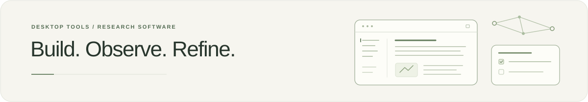

<picture>
  <source media="(prefers-color-scheme: dark)" srcset="assets/hero-dark.svg">
  
</picture>

[English](README.md) · **[走进我的个人实验室 ↗](https://kennymcsimpson.github.io/)**

[实验手记](https://kennymcsimpson.github.io/notes/) · [最近在做什么](https://kennymcsimpson.github.io/#now) · [RSS](https://kennymcsimpson.github.io/feed.xml)

我是 Kenny。写代码、做研究，也在搭一个让知识、工具与长期记忆彼此相连的工作环境。

### 一个还在生长的 Ecosystem

**Ecosystem** 把项目记忆、科研与独立评审、编码执行和工具连接串起来。**PI-Ecosystem** 是承载它们的桌面工作区，**Lyra** 是其中正在完善的管家与搭档。

PI 仍在本地开发，**源码尚未公开**。可以先从[交互星图](https://kennymcsimpson.github.io/#ecosystem)看看它们如何相连。

### 一点开源足迹

从遇到的小问题开始，修好它、补上测试，再交回上游。

| 项目 | 已合并的贡献 |
| :-- | :-- |
| Hugging Face · datasets | [远程 NIfTI 解码路径 · #8737](https://github.com/huggingface/datasets/pull/8737) |
| Microsoft · SkillOpt | [旧编码配置的兼容处理 · #304](https://github.com/microsoft/SkillOpt/pull/304) |
| Tencent · WeKnora | [关闭 HTTP 错误后遗留的 MCP SSE 响应 · #3930](https://github.com/Tencent/WeKnora/pull/3930) |
| OpenSandbox | [保留带 UTF-8 BOM 的首个 SSE 事件 · #2226](https://github.com/opensandbox-group/OpenSandbox/pull/2226) |

[40 个公开已合并 PR，36 个上游仓库](https://github.com/search?q=author%3AKennyMcSimpson+is%3Apr+is%3Amerged+is%3Apublic+-user%3AKennyMcSimpson&type=pullrequests) · 统计截至 2026 年 10 月 31 日。

---

*这里会随着 PI 一起长大。*
